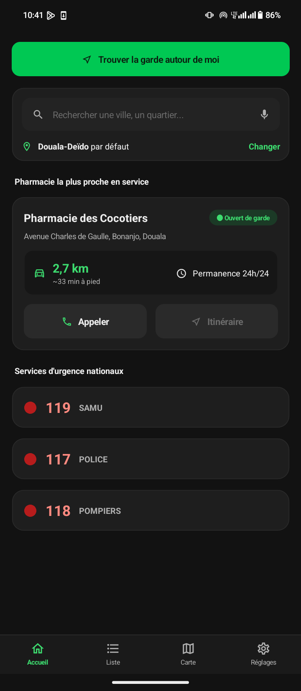
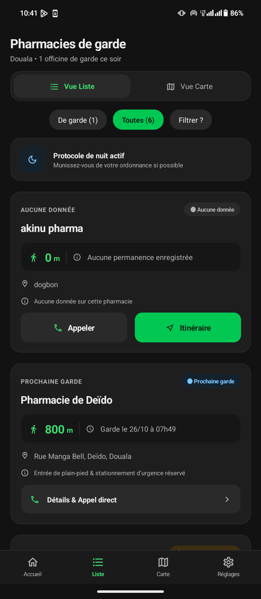
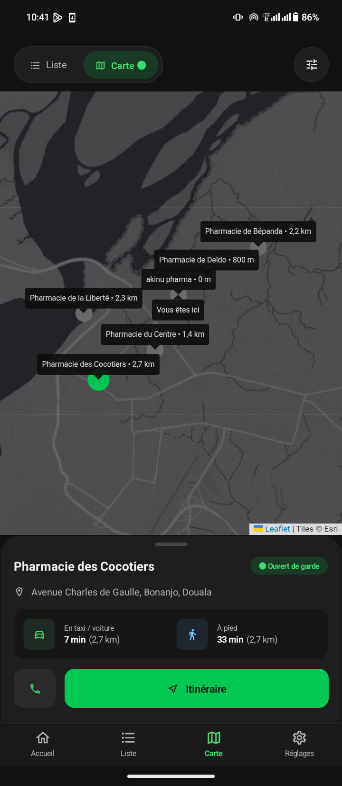
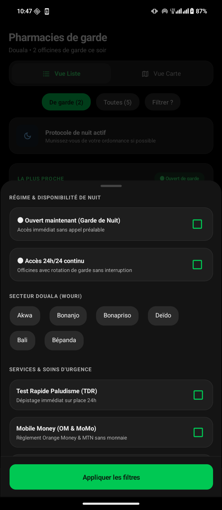
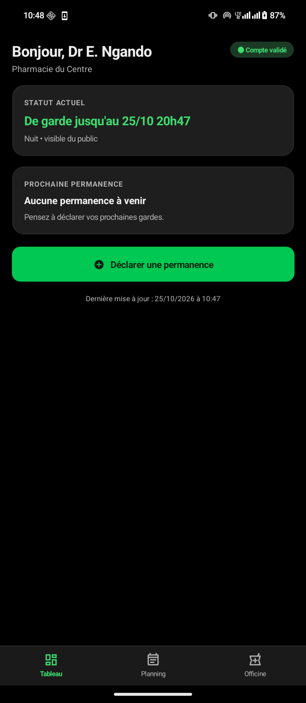

# PharmaGarde

> Application mobile (.NET MAUI) qui aide à trouver la pharmacie de garde la plus proche. Les informations de garde sont déclarées par les pharmaciens eux-mêmes.

Projet académique : ENSPD, GL5, atelier de développement mobile, année 2026/2027.

## Sommaire

1. [Présentation](#1-présentation)
2. [Fonctionnalités](#2-fonctionnalités)
3. [Règles de gestion](#3-règles-de-gestion)
4. [Parcours de démonstration](#4-parcours-de-démonstration)
5. [Captures](#5-captures)
6. [Installation et lancement](#6-installation-et-lancement)
7. [Configuration](#7-configuration)
8. [Architecture](#8-architecture)
9. [Charte graphique et écoconception](#9-charte-graphique-et-écoconception)
10. [Sécurité et données](#10-sécurité-et-données)
11. [Limites connues et évolutions](#11-limites-connues-et-évolutions)
12. [Auteurs et contexte](#12-auteurs-et-contexte)

**Comment lire ce document**

| Je veux... | Sections |
|---|---|
| Comprendre le projet et ce qu'il fait | 1, 2, 3 |
| Voir comment il est fonctionnel | 4, 5 |
| L'installer sur mon téléphone | 6, 7 |
| Comprendre le code | 8, 9 |
| Connaître ses limites | 10, 11 |

---

## 1. Présentation

### Le problème
Trouver une pharmacie ouverte la nuit, le week-end ou un jour férié est un besoin de santé publique fréquent, en particulier à Douala. L'information est dispersée (affichages en vitrine, annuaires, bouche-à-oreille), rarement à jour et difficile à lire dans l'urgence. À notre connaissance, il n'existe pas de source officielle ouverte (API ou jeu de données) des tours de garde au Cameroun.

### La solution
**Les pharmaciens s'inscrivent et déclarent eux-mêmes leurs permanences.** L'application publique les affiche, trie les pharmacies par distance, et permet d'appeler ou de lancer un itinéraire. Le public n'a **aucun compte à créer** : l'accès est direct, ce qui est essentiel en urgence.

### Les trois acteurs

| Acteur | Compte | Rôle |
|---|---|---|
| Public | Aucun | Rechercher, consulter, appeler, partir en itinéraire |
| Pharmacien | Oui, vérifié par l'administrateur | Déclarer les permanences de son officine |
| Administrateur | Compte interne | Valider, refuser, suspendre ou supprimer les comptes pharmaciens |

### Périmètre
- **Inclus :** application Android, espace pharmacien, espace administrateur, mode hors ligne, zone pilote de Douala.
- **Non inclus :** iOS, serveur en ligne partagé (voir [section 11](#11-limites-connues-et-évolutions)), notifications, paiement.

---

## 2. Fonctionnalités

### Côté public
- **Accueil :** la pharmacie de garde la plus proche est visible dès l'ouverture, avec ses boutons Appeler et Itinéraire, et les numéros d'urgence (SAMU 119, Police 117, Pompiers 118).
- **Recherche :** par géolocalisation (« Trouver la garde autour de moi »), par saisie libre (ville, quartier, nom) ou en choisissant sa zone à la main si le GPS est refusé.
- **Liste :** pharmacies triées par distance croissante. Deux puces : « De garde » (par défaut) et « Toutes ».
- **Carte :** carte avec un repère par pharmacie (vert si de garde, gris sinon) et votre position. Toucher un repère affiche son résumé, avec appel et itinéraire.
- **Filtres :** panneau superposé à la liste ou à la carte : de garde maintenant, service continu 24h/24, quartiers, services (test paludisme, Mobile Money, oxygénothérapie), rayon de recherche.
- **Fiche détaillée :** horaires, modalités de garde nocturne, services, pharmacien de permanence, date de mise à jour.
- **Appel et itinéraire :** ouverture de l'application Téléphone et de l'application de cartes du téléphone.
- **Favori, partage, historique :** une officine favorite, le partage d'une fiche (SMS, messageries) et l'historique des officines consultées.
- **Réglages :** zone favorite, GPS, mode sombre OLED, mémorisation hors ligne, vidage du cache, informations légales.
- **États complets :** chargement (squelettes), liste vide, erreur, hors ligne, « Aucune donnée sur cette pharmacie ».

### Côté pharmacien
- **Inscription :** nom, e-mail, mot de passe, numéro ONPC, officine, adresse, ville, quartier, téléphone, position GPS facultative, certification sur l'honneur(case à cocher).
- **Validation :** tant que l'administrateur n'a pas validé le compte, rien n'est publié.
- **Connexion et mot de passe oublié :** récupération en trois étapes (e-mail, code, nouveau mot de passe).
- **Tableau de bord :** statut actuel, prochaine permanence, alerte si aucune garde n'est prévue dans les 7 jours.
- **Planning :** permanences à venir et passées, création, modification, suppression.
- **Formulaire de permanence :** type (nuit, week-end, jour férié, 24h/24), début, fin, note d'accès, pharmacien de permanence. Les chevauchements et les dates incohérentes sont refusés.
- **Mon officine(réglages) :** coordonnées, horaires habituels, services proposés, position GPS.

### Côté administrateur
- Lister les comptes (en attente, validés, autres) avec le numéro ONPC à vérifier.
- **Valider, refuser, suspendre, réactiver, supprimer** (avec confirmation pour les actions sensibles).
- Suspendre un compte retire immédiatement ses gardes du côté public.

---

## 3. Règles de gestion

**Statut d'une pharmacie** (calculé à chaque affichage)

| Situation | Statut affiché |
|---|---|
| Une permanence est en cours | De garde |
| Sinon, une permanence est prévue | Prochaine garde (date et heure) |
| Sinon, il existe une permanence passée | Information ancienne (la mention ancienne s'accentue au-delà de 7 jours) |
| Aucune permanence, ou pharmacien non validé | **Aucune donnée sur cette pharmacie** |

- **Fraîcheur :** chaque information affiche sa date de mise à jour.
- **Pharmacie sans donnée :** Appeler et Itinéraire restent disponibles, avec un lien « Vous êtes le pharmacien ? Inscrivez votre officine ».
- **Vie privée :** la position GPS n'est demandée qu'avec l'accord de l'utilisateur, lue une seule fois (jamais suivie en continu), et sert uniquement à **calculer les distances sur le téléphone**.
- **Sans GPS :** les distances partent de la zone favorite (Akwa par défaut). Elle se change dans les réglages ou depuis l'accueil.
- **Hors ligne :** la dernière liste chargée est mémorisée avec sa date. Sans réseau, elle reste consultable, l'itinéraire est désactivé et l'appel reste possible.
- **Heures :** stockées en UTC, affichées à l'heure du Cameroun (UTC+1).
- **Quartiers :** la liste suit les officines enregistrées. Un nouveau quartier créé à l'inscription apparaît partout (listes de choix, filtres).
- **Publication :** seules les permanences d'un compte pharmacien **validé** sont visibles du public.

---

## 4. Parcours de démonstration

### Comptes de démonstration

| Rôle | Identifiant | Mot de passe |
|---|---|---|
| Pharmacien | `demo@pharmagarde.cm` | `Pharma2026` |
| Administrateur | `admin@pharmagarde.cm` | `Admin2026` |
| Code de récupération (simulé) | | `123456` |

Ces identifiants sont écrits dans le code : ils servent uniquement à la démonstration.

### Scénarios

| Pour voir... | Faire |
|---|---|
| La pharmacie de garde la plus proche | Lancer l'application : l'accueil l'affiche |
| Les 4 statuts | Liste, puce **Toutes** : de garde, prochaine garde, information ancienne, aucune donnée |
| « Aucune donnée » | Ouvrir la Pharmacie de Bépanda |
| Un pharmacien qui publie | Connexion pharmacien, Planning, déclarer une garde en cours, puis consulter l'accueil |
| La validation par l'administrateur | `ValidationAutomatique = false` (section 7), inscrire une officine, se connecter en administrateur, valider |
| Une suspension | Administrateur, onglet « Validés », Suspendre : la pharmacie passe à « Aucune donnée » côté public |
| Le mode hors ligne | Activer le mode avion, Liste, « Utiliser les données hors ligne » |
| Un nouveau quartier | Inscription pharmacien, quartier, « Autre quartier… » |
| Repartir de zéro | Réglages, « Réinitialiser les données de démonstration » |

---

## 5. Captures


| Accueil | Liste | Carte |
|---|---|---|
|  |  |  |

| Fiche pharmacie | Filtres | Espace pharmacien |
|---|---|---|
|  |  |  |

---

## 6. Installation et lancement

### Prérequis
- Visual Studio avec la charge de travail **« Développement d'applications mobiles .NET MAUI »** 
- Un téléphone Android avec le mode développeur et le débogage USB activés, ou un émulateur Android.
- Une connexion Internet (téléchargement des paquets, et affichage de la carte).

### Étapes
1. Cloner le dépôt : `git clone https://GitHub.com/Frange-Parker/PharmaGarde_.Net_MAUI.git`
2. Ouvrir `PharmaGarde.sln` dans Visual Studio.
3. Restaurer les paquets NuGet.
4. Sélectionner **Release** et votre appareil Android.
5. Lancer avec **Débogage, Démarrer sans débogage (Ctrl+F5)**.

Le mode **Release** est recommandé sur téléphone : en Debug, l'application est nettement plus lente.

### Problèmes fréquents

| Symptôme | Solution |
|---|---|
| Avertissement NuGet « index de service » | Réseau bloqué : sans effet si les paquets sont déjà en cache |
| Icônes manquantes (carrés vides) | Vérifier `Resources/Fonts/MaterialIcons-Regular.ttf` (police à jour, 69 icônes) |
| Ancienne version qui persiste | Désinstaller l'application du téléphone, puis relancer |
| Carte blanche ou en erreur | La carte a besoin d'Internet |
| Distances très grandes | Normal si vous êtes loin de Douala : désactivez le GPS dans les réglages |
| Bouton Appeler sans effet | Tester sur un vrai téléphone (un émulateur peut ne pas avoir d'application Téléphone) |

---

## 7. Configuration

| Réglage | Fichier | Rôle |
|---|---|---|
| `ValidationAutomatique` | `Helpers/Config.cs` | `true` : comptes validés tout de suite ; `false` : validation par l'administrateur |
| `ModeDemo` | `Helpers/Config.cs` | Affiche les outils de démonstration |
| `CodeResetDemo` | `Helpers/Config.cs` | Code simulé de récupération de mot de passe |
| `SeuilAncienJours` | `Helpers/Config.cs` | Seuil de l'information ancienne |
| `NumeroDemo` | `Helpers/Config.cs` | Numéro des pharmacies de démonstration |
| `CleCarto` | `Views/CartePage.xaml.cs` | Clé CARTO facultative pour le fond de carte |

### Fond de carte et clé CARTO
- La carte est une page Leaflet affichée dans un `WebView`.
- **Sans clé** (`CleCarto` vide) : un fond de carte gris sombre Esri est utilisé.
- **Avec clé** : CARTO exige désormais une clé gratuite sur ses tuiles. Elle se demande sur <https://carto.com/basemaps/apikey/>.

---

## 8. Architecture

### Vue d'ensemble

```
Vues (XAML)  ->  ViewModels (Connexion, Admin)  ->  Services  ->  Dépôt JSON (serveur simulé)
                                                       |
                                              Modèles (Pharmacie, Permanence, Pharmacien)
```

### Structure du projet

```
PharmaGarde/
├── MauiProgram.cs, App.xaml(.cs), AppShell.xaml(.cs)   Démarrage et navigation
├── Platforms/Android/AndroidManifest.xml               Permissions (réseau, position, appel)
├── Resources/                                          Police d'icônes, couleurs, styles
├── Models/                                             Pharmacie, Permanence, Pharmacien, PharmacieVue...
├── Services/                                           Règles métier et accès aux données
│     Depot, CalculStatut, PharmacieService, AuthService,
│     AdminService, PermanenceService, LocalisationService, Securite
├── ViewModels/                                         BaseViewModel, RelayCommand,
│                                                       ConnexionViewModel, AdminViewModel, CompteVue
├── Helpers/                                            Config, Icons, Outils, Heure, EtatFiltres, DonneesDemo
├── Controls/                                           Composants réutilisables (BarreNav, ChampSaisie,
│                                                       ChampChoix, EtatVide, CartePharmacie, PanneauFiltres...)
└── Views/                                              Un écran par page (public, pharmacien, administration)
```

### Points d'architecture
- **Navigation :** Shell .NET MAUI pour les pages principales, une barre du bas dessinée par l'application (4 onglets publics, 3 onglets pharmacien).
- **Données :** un fichier JSON local joue le rôle de serveur (`Depot`). Une copie publique datée alimente le mode hors ligne.
- **Statut de garde :** calculé dans `CalculStatut` à partir des permanences et de l'heure courante.
- **MVVM :** appliqué à la **Connexion** et à l'**Administration** (ViewModels, commandes, bindings). Les autres écrans fonctionnent en code-behind avec une couche de services : leur migration est prévue.

---

## 9. Charte graphique et écoconception

- **Thème sombre uniquement.** Police système
- **Palette :** fond `#121212` (noir pur en mode OLED), cartes `#1E1E1E`, vert principal `#00C853`, vert d'accent `#3DDC6F`, erreur `#FF8A80`, avertissement `#FFB74D`, information `#7CC4FF`.
- **Typographie :** titres 28 et 20 en gras, texte 14, légende 12. Aucun texte sous 12.
- **Espacement :** grille de 8 px, marges d'écran de 16, zones tactiles d'au moins 48 px.
- **États des composants :** normal, actif, désactivé, erreur.
- **Icônes :** Google Material Icons, sous forme de police vectorielle.

**Écoconception**
- Thème sombre par défaut, mode OLED à fond noir pur.
- Icônes vectorielles uniquement, aucune image embarquée, aucune animation superflue.
- Mémorisation locale pour limiter les échanges réseau.
- Distances calculées sur le téléphone, position lue une seule fois, pas de suivi continu.
- La liste n'est reconstruite et la copie hors ligne réécrite que si les données ont changé.

---

## 10. Sécurité et données

- Les mots de passe sont **hachés** .
- Blocage de 30 secondes après 5 échecs de connexion consécutifs.
- La position GPS n'est jamais transmise.
- Les comptes de démonstration et le compte administrateur sont écrits dans le code : **à supprimer en production**.
- **Les pharmacies, adresses et permanences sont fictives** (données de démonstration) et clairement signalées comme telles dans l'application.

---

## 11. Limites connues et évolutions

### Limites de cette version

| Limite | Détail |
|---|---|
| Serveur simulé | Les données sont stockées sur le téléphone : les permanences saisies ne sont pas partagées entre appareils |
| Administration dans l'application | En production, elle devrait être une interface web séparée avec authentification forte |
| Carte | Nécessite Internet |
| MVVM partiel | Appliqué à la Connexion et à l'Administration seulement |
| Données fictives | Aucune pharmacie réelle |
| Récupération du mot de passe | Le code est simulé (aucun e-mail envoyé) |
| Tests | Pas de tests automatisés |

### Évolutions envisagées
- API en ligne (ASP.NET Core) avec base de données partagée.
- Annuaire réel des officines à partir d'OpenStreetMap, les gardes restant déclarées par les pharmaciens.
- Interface web d'administration, avec motif de refus ou de suspension, journal d'audit, détection des doublons de numéro ONPC.
- Signalement d'erreurs par le public.
- Confirmation avant l'enregistrement d'une permanence déjà passée.
- Migration complète vers MVVM.
- Notifications, version iOS.

---

## 12. Auteurs et contexte

- **Auteur :** NOLACK KAWUNJIBI Frange Parker
- **Encadrement :** M. DADA NELSON
- **Établissement :** ENSPD, GL5, 2026/2027, atelier de développement mobile
